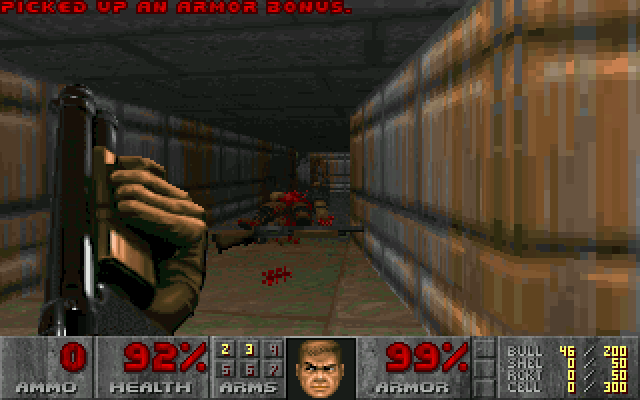
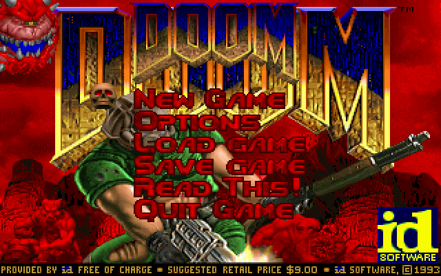
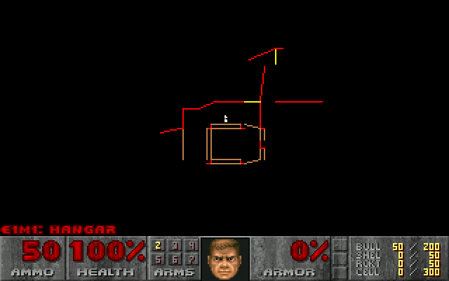

# DOOM for the Polyend Tracker

Doom as its own firmware for the **original Polyend Tracker**. It boots
straight into Doom, plays sound effects through the Tracker, sends the music
out as MIDI, and can install another firmware (OpenTracker or stock) when you
want your Tracker back.



| Menu | Automap |
|---|---|
|  |  |

*Screenshots from the PC build, which draws the same frames as the Tracker.*

Not affiliated with Polyend or id Software. No game data is included.

## Install

1. Copy `PolyendTrackerDOOMv3.ptf` to `/Firmware` on the SD card. Keep the file name.
2. Copy a WAD to `/DOOM` on the card: `doom1.wad` (free shareware), `doom.wad`,
   `doom2.wad`, `tnt.wad`, `plutonia.wad` or a [Freedoom](https://freedoom.github.io/) WAD.
3. On the Tracker: **Config > Firmware update**, pick the Doom file, confirm.

The Tracker restarts into a launcher: pick a WAD and press **Play**.

## Going back

In the launcher, choose **Firmware update**, pick an image from `/Firmware`
(e.g. an OpenTracker image or `PolyendTracker_1.9.2.ptf`) and confirm. The same
menu appears after **Quit Game**.

Keep the stock `PolyendTracker_1.9.2.ptf` in `/Firmware`, just in case.

## Controls

| Tracker | Doom |
|---|---|
| Arrows | move and turn |
| Insert / Delete | strafe left / right |
| Play | fire |
| Rec | use (doors, switches) |
| Shift (hold) | run |
| Encoder | turn |
| Encoder push + encoder | walk (clockwise forward) |
| F1 | menu |
| F2 or encoder push | select |
| F3 / F4 | yes / no |
| F5 / F6 / F7 / F8 | save / load / quick save / quick load |
| Note / Instr | previous / next weapon |
| Pattern | automap |
| Pads, top row | weapons 1–7 |
| Pads, other rows | letters (save names, cheats) |
| Help | controls card on screen |
| Aux | show fps |
| Power (hold) | power off |

The labels under the picture show what F1–F8 do, and **Help** opens a card with
all controls. When you save, an on-screen keyboard appears, laid out like the
pads: press a pad to type its letter, or pick with the encoder and press it.
**F2** saves, **F1** cancels.

The pad lights show your weapons, keys, health and armour.

## Sound

Sound effects play from the Tracker's outputs. **Music goes out as MIDI** on the
MIDI out and USB ports: connect a General MIDI synth (or a computer with a
soft synth) to hear it.

## Status

Earlier builds run on a real Tracker. v3 adds the key labels, the controls card and
the save keyboard; it is not tested on hardware yet. Next: music played by
the Tracker itself (OPL2 FM, as on the original PC version).

## Building

Needs `arm-none-eabi-gcc` and Python 3; the PC version also needs SDL2.

```sh
git submodule update --init
make              # Tracker firmware: build/PolyendTrackerDOOMv3.ptf
make host         # PC version: build/host/doom-host -iwad doom1.wad
make test host-check
```

Built on [OpenTracker](https://github.com/sandlbn/polyend-tracker-re) (board support)
and [doomgeneric](https://github.com/ozkl/doomgeneric) (the Doom engine, GPL-2.0).
See [plan.md](plan.md) for how it works and what's next.
